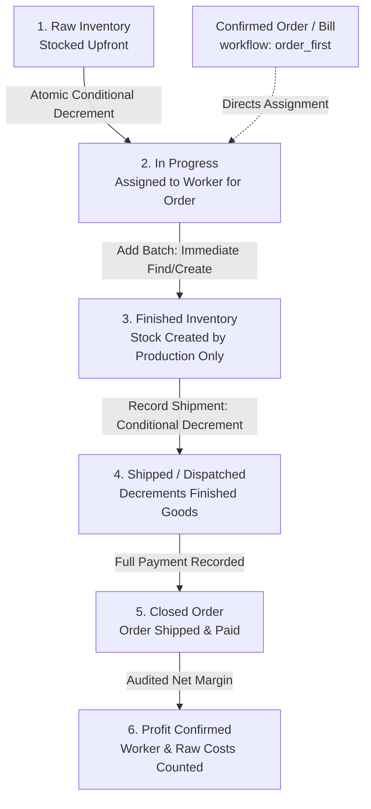

# InsightLoop Order-First Production Workflow Runbook

This runbook documents the architecture, lifecycle stages, data model, API endpoints, failure modes, race safety, and operational recovery for InsightLoop's Make-to-Order production workflow.

---

## 1. Overview & Business Model

InsightLoop implements a strict **Make-to-Order** production workflow (`Raw -> In Progress -> Finished -> Shipped`).

In this model:
- Only **raw materials** are stocked upfront in inventory.
- Finished products have **no pre-existing stock**.
- A bill (whether `kacha` or `pakka`) represents a confirmed order. Creating a bill **never touches inventory**.
- Finished stock is created **strictly via worker production** tied to a specific order.
- Finished goods leave inventory **strictly upon shipment** against that order.
- Every inventory transition (raw issue, batch output, shipment dispatch, raw return) is recorded in an immutable, tenant-scoped ledger (`stock_movements`).



---

## 2. Production Lifecycle Walkthrough

### 2.1 Stage 1: Raw Material Stocking
- Raw materials (e.g. yarn, fabric, metals) are received and inventoried under `type: 'raw'` via `POST /api/v1/inventory/raw`.
- Finished items (`type: 'finished'`) start with quantity `0`. The UI prohibits manual creation, editing of quantities, or deletion of finished goods to protect production truth.

### 2.2 Stage 2: Bill Creation (`confirmed`)
- An order is placed by creating a bill via `POST /api/v1/bills/` (or `POST /api/v1/bills/kacha`, `POST /api/v1/bills/pakka`).
- Every new bill is tagged with `workflow: 'order_first'`.
- Duplicate product line names within the bill (case-insensitive, trimmed) are rejected with HTTP 400.
- Creating or editing an `order_first` bill **never modifies raw or finished inventory**. Any incoming `inventory_item_id` is coerced to `null`.
- The bill's initial `order_status` is `confirmed`.

### 2.3 Stage 3: Worker Assignment & Raw Material Issue (`in_production`)
- Work is assigned via `POST /api/v1/workers/:worker_id/materials`.
- Mandatory parameters: `bill_id`, `material_name` (must match a bill line), `quantity` (target output units <= ordered minus active targets of other assignments), `raw_item_id` (inventory item of `type: 'raw'`).
- Optional parameters: `raw_per_unit` (default `1.0`), `issue_quantity` (default = `quantity * raw_per_unit`), `price_per_unit` (default = raw item's cost price), `wage_amount`.
- Raw material is atomically deducted from raw inventory using a conditional decrement (`quantity >= requested`). If stock is insufficient, HTTP 400 is returned, and nothing is created.
- A ledger record (`type: 'raw_issue'`) is written to `stock_movements`.
- The bill's `order_status` transitions to `in_production`.

### 2.4 Stage 4: Progressive Batch Output (`production_in`)
- Workers deliver finished products in one or more batches via `POST /api/v1/workers/materials/:assignment_id/batches`.
- Output quantity cannot exceed `target - produced` (preventing unbacked stock creation).
- Increments `produced_quantity` atomically with race protection (`produced_quantity <= target - qty`).
- Finds or creates the corresponding finished inventory item in `inventory_items` (`sku` generated via next SKU sequence, `selling_price` from bill rate, `cost_price: 0`).
- Finished inventory stock is immediately incremented by the batch quantity.
- A ledger record (`type: 'production_in'`) is written to `stock_movements`.
- The batch is marked with `synced_to_inventory: true`.

### 2.5 Stage 5: Assignment Completion or Cancellation
- **Completion** (`PUT /api/v1/workers/materials/:assignment_id/complete`):
  - Any unsynced batches are synced idempotently.
  - Unused raw material returned by the worker (`raw_returned_quantity`) is added back to raw inventory, writing a `raw_return` ledger entry.
  - A worker wage pay record is created with `source_assignment_id`.
  - Assignment status becomes `completed`. Wastage is computed:
    $$\text{wastage} = \max\left(0, (\text{raw\_issued} - \text{raw\_returned}) - \text{produced} \times \text{raw\_per\_unit}\right)$$
  - Completed assignments are immutable. If produced quantity is less than target, the short run is permitted; the bill line remains open for future assignments.
- **Cancellation** (`PUT /api/v1/workers/materials/:assignment_id/cancel`):
  - Permitted only when `status === 'open'` and `produced_quantity === 0`.
  - All issued raw material ($\text{raw\_issued} - \text{raw\_returned}$) is refunded to raw inventory.
  - A `raw_return` ledger entry is written.
  - Assignment status becomes `cancelled`. Cancelled assignments create no wages and are excluded from order progress.

### 2.6 Stage 6: Dispatch & Shipments (`partially_shipped` / `shipped`)
- Shipments are recorded via `POST /api/v1/bills/:id/shipments`.
- Operators can ship specific line items or use `ship_all: true` to ship all produced goods ready for dispatch.
- Quantity per line must satisfy:
  $$0 < \text{quantity} \le \text{produced} - \text{already\_shipped}$$
- Finished stock is decremented conditionally and atomically (`quantity >= requested`). If any item in the batch fails, earlier deductions are automatically rolled back.
- Ledger records (`type: 'shipment_out'`) are written for each shipped product line.
- The shipment record is appended to `bill.shipments`.
- If some items remain unshipped, bill `order_status` becomes `partially_shipped`. When all ordered lines are 100% shipped, `order_status` becomes `shipped`.

### 2.7 Stage 7: Payment & Order Closure (`closed`)
- Payments from the buyer are recorded via `POST /api/v1/bills/:id/record-payment`.
- Once `order_status === 'shipped'` and the bill is paid in full ($\text{amount\_received} \ge \text{grand\_total}$), the order status automatically transitions to `closed`.

### 2.8 Stage 8: Audited Profit Confirmation
- Profit preview (`GET /api/v1/bills/:id/profit-preview`) aggregates:
  - Real raw material costs:
    $$\sum (\text{raw\_issued} - \text{raw\_returned}) \times \text{price\_per\_unit}$$
  - Worker wages: from linked assignments and pay records.
  - Transportation costs and miscellaneous costs.
- For `order_first` bills, confirming profit (`POST /api/v1/bills/:id/confirm-profit`) is guarded: the bill must be fully shipped (`order_status === 'shipped' || 'closed'`).

---

## 3. Data Model & Schema Specifications

### 3.1 Stock Movements Ledger (`stock_movements`)

Indexed by `{ company_id: 1, bill_id: 1, date: -1 }` in `apps/api/src/db/mongo.ts`.

| Field | Type | Description |
| :--- | :--- | :--- |
| `_id` | `ObjectId` | Unique movement identifier |
| `company_id` | `string` | Tenant isolation scope |
| `date` | `string` (ISO) | Movement timestamp |
| `type` | `string` | `'raw_issue'` \| `'raw_return'` \| `'production_in'` \| `'shipment_out'` |
| `item_id` | `string` / `ObjectId` | Inventory item ID moved |
| `item_name` | `string` | Snapshot name of inventory item |
| `quantity` | `number` | Positive quantity moved |
| `bill_id` | `string` \| `null` | Associated bill ID |
| `assignment_id` | `string` \| `null` | Associated worker assignment ID |
| `worker_id` | `string` \| `null` | Associated worker ID |
| `notes` | `string` | Human-readable explanation |
| `created_at` | `Date` | Wall-clock creation timestamp |

### 3.2 Material Assignments (`material_assignments`)

Indexed by `{ company_id: 1, bill_id: 1 }` and `{ company_id: 1, worker_id: 1 }`.

| Field | Type | Description |
| :--- | :--- | :--- |
| `bill_id` | `string` | Mandatory order reference |
| `material_name` | `string` | Target finished product name (matches bill line) |
| `quantity` | `number` | Target finished output units |
| `raw_item_id` | `string` | Reference to raw inventory item |
| `raw_item_name` | `string` | Snapshot of raw item name |
| `raw_unit` | `string` | Raw material unit of measure |
| `raw_per_unit` | `number` | Raw consumption multiplier (default 1.0) |
| `raw_issues` | `Array` | Log of raw allocations `[{ issue_id, quantity, date, notes }]` |
| `raw_issued_quantity` | `number` | Total raw units issued to worker |
| `raw_returned_quantity`| `number` | Total raw units returned by worker |
| `produced_quantity` | `number` | Total finished output produced across batches |
| `finished_item_id` | `string` \| `null` | Auto-linked finished inventory item ID |
| `batches` | `Array` | Progressive batches `[{ batch_id, quantity, date, notes, synced_to_inventory }]` |
| `price_per_unit` | `number` | Cost snapshot per raw unit |
| `wage_amount` | `number` | Artisan wage allocated for completing this run |
| `status` | `string` | `'open'` \| `'completed'` \| `'cancelled'` |
| `wastage_quantity` | `number` \| `null` | Excess raw units consumed beyond formula output |

### 3.3 Bills (`bills`)

| Field | Type | Description |
| :--- | :--- | :--- |
| `workflow` | `string` | `'order_first'` on new bills; omitted on legacy bills |
| `shipments` | `Array` | Dispatch log `[{ shipment_id, date, notes, items: [{ product_name, quantity, finished_item_id }] }]` |
| `lines` | `Array` (derived) | Line-level progress: `ordered`, `targeted`, `produced`, `shipped`, `ready_to_ship` |
| `order_status` | `string` (derived) | `'confirmed'` \| `'in_production'` \| `'partially_shipped'` \| `'shipped'` \| `'closed'` |

---

## 4. API Endpoint Catalog

All routes require authentication header: `Authorization: Bearer <access_token>`.

### 4.1 Production & Worker Material Management

#### Create Material Assignment
- **Route**: `POST /api/v1/workers/:worker_id/materials`
- **Request**:
  ```json
  {
    "bill_id": "6ad5fc37dd911eddc4078038",
    "material_name": "Silk Scarf A",
    "quantity": 10,
    "raw_item_id": "6ad5fc37dd911eddc4078036",
    "raw_per_unit": 2,
    "issue_quantity": 20,
    "wage_amount": 600,
    "date": "2026-10-19",
    "notes": "Urgent festive delivery"
  }
  ```
- **Response** (HTTP 201):
  ```json
  {
    "id": "6ad5fc37dd911eddc4078039",
    "material_name": "Silk Scarf A",
    "quantity": 10,
    "raw_item_id": "6ad5fc37dd911eddc4078036",
    "raw_issued_quantity": 20,
    "produced_quantity": 0,
    "status": "open"
  }
  ```

#### Issue Additional Raw Material
- **Route**: `POST /api/v1/workers/materials/:assignment_id/issues`
- **Request**:
  ```json
  {
    "quantity": 5,
    "date": "2026-10-19",
    "notes": "Extra silk for fringe detailing"
  }
  ```
- **Response** (HTTP 201): Assignment object with incremented `raw_issued_quantity`.

#### Record Batch Output
- **Route**: `POST /api/v1/workers/materials/:assignment_id/batches`
- **Request**:
  ```json
  {
    "quantity": 6,
    "date": "2026-10-19",
    "notes": "First crate completed"
  }
  ```
- **Response** (HTTP 201):
  ```json
  {
    "id": "6ad5fc37dd911eddc4078039",
    "produced_quantity": 6,
    "batches": [
      {
        "batch_id": "6ad5fc37dd911eddc4078040",
        "quantity": 6,
        "synced_to_inventory": true
      }
    ]
  }
  ```

#### Complete Assignment
- **Route**: `PUT /api/v1/workers/materials/:assignment_id/complete`
- **Request**:
  ```json
  {
    "raw_returned_quantity": 1
  }
  ```
- **Response** (HTTP 200): Assignment object with `status: "completed"`, `wastage_quantity`, and linked `pay_record_id`.

#### Cancel Assignment
- **Route**: `PUT /api/v1/workers/materials/:assignment_id/cancel`
- **Response** (HTTP 200): Assignment object with `status: "cancelled"`.

---

### 4.2 Order Shipments & Movements

#### Record Shipment
- **Route**: `POST /api/v1/bills/:id/shipments`
- **Request (Selective Items)**:
  ```json
  {
    "items": [
      { "product_name": "Silk Scarf A", "quantity": 4 }
    ],
    "notes": "First air freight dispatch"
  }
  ```
- **Request (Ship All)**:
  ```json
  {
    "ship_all": true,
    "notes": "Final balance dispatch"
  }
  ```
- **Response** (HTTP 201): Serialized bill object with updated `lines`, `shipments`, and `order_status`.

#### Query Stock Movement Ledger
- **Route**: `GET /api/v1/inventory/movements?bill_id=:bill_id`
- **Response** (HTTP 200):
  ```json
  [
    {
      "id": "6ad5fc37dd911eddc4078041",
      "type": "raw_issue",
      "item_id": "6ad5fc37dd911eddc4078036",
      "item_name": "Mulberry Silk Yarn",
      "quantity": 20,
      "bill_id": "6ad5fc37dd911eddc4078038",
      "created_at": "2026-10-19T10:00:00.000Z"
    },
    {
      "id": "6ad5fc37dd911eddc4078042",
      "type": "production_in",
      "item_id": "6ad5fc37dd911eddc407803a",
      "item_name": "Silk Scarf A",
      "quantity": 6,
      "bill_id": "6ad5fc37dd911eddc4078038",
      "created_at": "2026-10-19T11:00:00.000Z"
    },
    {
      "id": "6ad5fc37dd911eddc4078043",
      "type": "shipment_out",
      "item_id": "6ad5fc37dd911eddc407803a",
      "item_name": "Silk Scarf A",
      "quantity": 4,
      "bill_id": "6ad5fc37dd911eddc4078038",
      "created_at": "2026-10-19T12:00:00.000Z"
    }
  ]
  ```

---

## 5. Failure Modes, Race Safety & Recovery

### 5.1 Race Safety in Batch Recording (Rule R5)
To prevent concurrent workers from exceeding an order's target output:
- Batch registration uses MongoDB conditional update filters:
  ```typescript
  {
    _id: new ObjectId(assignmentId),
    company_id: scope.companyId,
    status: 'open',
    $expr: {
      $lte: [
        { $add: [{ $ifNull: ['$produced_quantity', 0] }, newBatchQty] },
        '$quantity'
      ]
    }
  }
  ```
- If two batch requests arrive simultaneously for a remaining balance of 4, only one will satisfy the `$lte` filter. The second request returns HTTP 400: `Output can never exceed the order, that would create stock without an order.`

### 5.2 Interrupted Batch Sync Recovery (Rule R5 / R6)
When a batch is accepted, the assignment document records the batch with `synced_to_inventory: false`. It then immediately attempts to find/create the finished item, adjust finished stock, write the `production_in` ledger, and update `synced_to_inventory: true`.

If the database or server crashes between recording the batch and syncing stock:
1. The batch remains in the database with `synced_to_inventory: false`.
2. `completeAssignment` (`apps/api/src/modules/workers/workers.service.ts`) scans for any batches with `synced_to_inventory !== true`.
3. It performs the find/create and stock increment for any unsynced batches idempotently before finalizing completion.
4. Operators can also inspect unsynced batches directly in the assignment detail payload.

### 5.3 Atomic Multi-Item Shipment Rollback (Rule R8)
When dispatching a multi-item shipment:
- Each product line is decremented conditionally (`quantity >= ship_qty`).
- If any line fails (e.g. concurrent shipment decremented stock, or insufficient finished goods), the transaction loops back over all previously decremented items in that request, refunds their stock atomically, deletes their corresponding ledger entries, and throws HTTP 400 with the exact shortfall.
- The shipment record is never appended to the bill unless all items successfully decrement.

### 5.4 Deletion Protection (Rule R14)
- Workers with existing material assignments cannot be deleted (`DELETE /api/v1/workers/:id` returns HTTP 400). This prevents orphaned raw material records or missing worker history.
- Bills with active assignments cannot be deleted.

---

## 6. Verification & Automated Quality Gates

Every code change touching the order-first workflow must verify against the following test suites:

```bash
# 1. Run full unit and integration test suite
pnpm test

# 2. Run standalone 16-step E2E business flow verification
node scripts/e2e_order_flow.mjs

# 3. Verify codebase purity and citations
node scripts/check_no_python.mjs
node scripts/check_citations.mjs

# 4. Verify branch coverage (>=90% per monitored file)
node scripts/check_branch_coverage.mjs

# 5. Verify architecture wiring and route reciprocity
node scripts/check_wiring.mjs
node scripts/check_silent_errors.mjs
```

Related source implementations:
- Bill service: `apps/api/src/modules/bills/bills.service.ts`
- Worker service: `apps/api/src/modules/workers/workers.service.ts`
- Inventory service: `apps/api/src/modules/inventory/inventory.service.ts`
- Database indexes: `apps/api/src/db/mongo.ts`
- E2E script: `scripts/e2e_order_flow.mjs`
